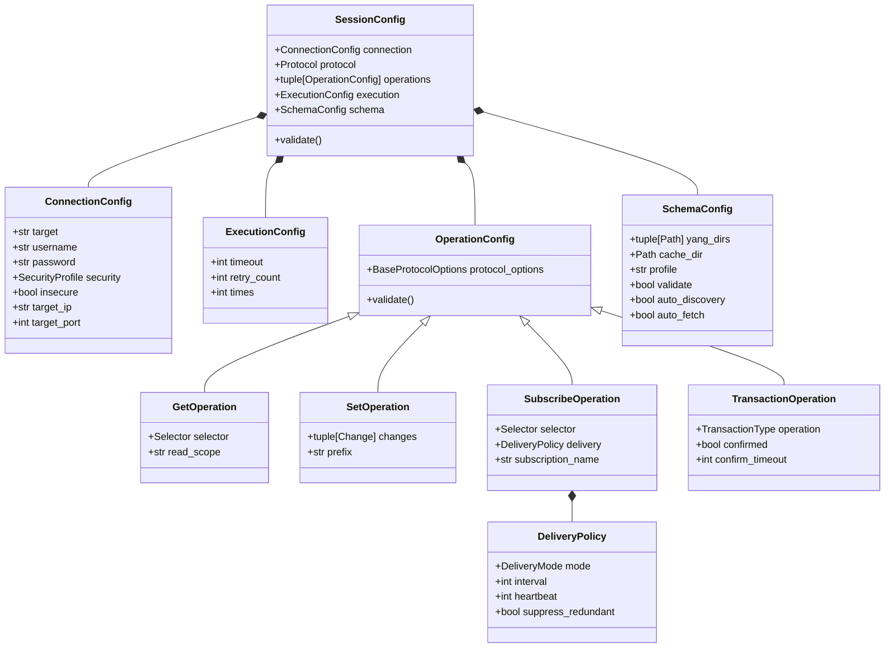

# Configuration & Domain Models (`config/`)

## 1. Overview

The [`config/`](__init__.py) package defines the core domain models and immutable configuration dataclasses for **`netmgnt-client-py`**. It establishes a strictly decoupled configuration boundary between:
* **Network Transport & Authentication** ([`ConnectionConfig`](model.py))
* **Execution & Concurrency Policies** ([`ExecutionConfig`](model.py))
* **Protocol-Neutral Semantic Intent** ([`OperationConfig`](operations.py))
* **Protocol-Specific Options** ([`BaseProtocolOptions`](protocol_options/base.py))
* **YANG Schema & Caching Profiles** ([`SchemaConfig`](schema.py), [`SchemaProfile`](schema.py))
* **Telemetry Delivery Modes** ([`DeliveryMode`](delivery.py), [`DeliveryPolicy`](delivery.py))

By separating transport credentials from operational intent, the engine allows reuse of identical operations across diverse targets and seamless translation across gNMI, NETCONF, and future protocols (RESTCONF).

---

## 2. Module Inventory

| File | Primary Exports | Responsibility |
| :--- | :--- | :--- |
| [`config/model.py`](model.py) | `SessionConfig`, `ConnectionConfig`, `ExecutionConfig`, `OutputConfig`, `Protocol`, `OutputType`, `OutputFormat` | Top-level session composition, transport parameters, retry/timeout policies, and output sinks. |
| [`config/operations.py`](operations.py) | `OperationConfig`, `CapabilitiesOperation`, `GetOperation`, `GetConfigOperation`, `SetOperation`, `EditConfigOperation`, `SubscribeOperation`, `GetSchemaOperation`, `TransactionOperation`, `NetconfTransactionOperation`, `Change`, `ChangeType` | Semantic operations representing client intent across unary and streaming protocols. |
| [`config/delivery.py`](delivery.py) | `DeliveryMode`, `DeliveryPolicy` | Protocol-neutral telemetry delivery semantics conforming to RFC 8641 (YANG-Push). |
| [`config/selectors.py`](selectors.py) | `Selector`, `PathSelector`, `FilterSelector` | Path-based targeting (gNMI/RESTCONF) and expression-based filtering (XPath/Subtree XML). |
| [`config/schema.py`](schema.py) | `SchemaConfig`, `SchemaProfile`, `ModuleRef`, `SubmoduleRef`, `FeatureRef`, `DeviationRef` | Immutable schema options, module references, and canonical SHA-256 profile fingerprints. |
| [`config/protocol_options/`](protocol_options/) | `BaseProtocolOptions`, `GnmiOptions`, `NetconfOptions` | Encapsulates protocol-specific wire knobs (encodings, datastores, locks, confirmed commits). |

---

## 3. Architecture & Data Flow



---

## 4. Key Component Reference

### 4.1 `SessionConfig` ([`config/model.py`](model.py))
Immutable dataclass (`frozen=True, kw_only=True`) that binds connection details with execution policies and an ordered sequence of operations.
* **`operations`**: A tuple of [`OperationConfig`](operations.py) instances. Single operations (`operation=...`) are automatically normalized to a 1-element tuple during initialization.
* **`connection`**: Target IP/port extraction, authentication credentials, and TLS/SSH profiles.
* **`execution`**: Execution timeout (seconds), retry count, and repetition multiplier (`times`).
* **`schema`**: Session-level YANG schema directories, validation flags, and cache path.

### 4.2 Semantic Operations ([`config/operations.py`](operations.py))
Protocol-agnostic operational intents:
* **`CapabilitiesOperation`**: Discover supported YANG models, versions, and wire encodings.
* **`GetOperation` / `GetConfigOperation`**: Query operational state or configuration datastores via a [`Selector`](selectors.py).
* **`SetOperation` / `EditConfigOperation`**: Apply an atomic list of [`Change`](operations.py) objects (`MERGE`, `REPLACE`, `DELETE`, `REMOVE`).
* **`SubscribeOperation`**: Long-running telemetry subscription bounded by a [`DeliveryPolicy`](delivery.py).
* **`TransactionOperation` / `NetconfTransactionOperation`**: Explicit candidate datastore lifecycle commands (`lock`, `unlock`, `validate`, `commit`, `discard-changes`).

### 4.3 Protocol-Neutral `DeliveryMode` ([`config/delivery.py`](delivery.py))
Conforms to RFC 8641 (YANG-Push) and maps seamlessly between gNMI and NETCONF subscription semantics:

| `DeliveryMode` | Meaning / RFC 8641 Mapping | gNMI Translation | NETCONF Translation |
| :--- | :--- | :--- | :--- |
| `PERIODIC` | Time-interval recurring sampling | `STREAM` mode with `SAMPLE` | Periodic YANG-push subscription |
| `EVENT_DRIVEN` | State change notifications | `STREAM` mode with `ON_CHANGE` | RFC 5277 / On-change notifications |
| `SNAPSHOT` | Single point-in-time state capture | `ONCE` mode | Unary `<get>` / `<get-config>` |
| `ON_DEMAND` | Client-triggered interactive polling | `POLL` mode | Client on-demand poll |
| `SERVER_DETERMINED` | Target selects optimal telemetry mode | `STREAM` mode with `TARGET_DEFINED` | Target-selected subscription mode |

### 4.4 `SchemaProfile` ([`config/schema.py`](schema.py))
Represents the exact YANG schema capability of a device:
* Contains canonical tuples of [`ModuleRef`](schema.py), `SubmoduleRef`, `FeatureRef`, and `DeviationRef`.
* **`profile_id`**: Deterministic SHA-256 hash computed over normalized, alphabetically sorted canonical JSON. Decoupled from host/port to enable cross-device schema caching.

---

## 5. Usage Examples

### 5.1 Programmatic `SessionConfig` Construction
```python
from pathlib import Path
from config.model import SessionConfig, ConnectionConfig, ExecutionConfig, Protocol
from config.operations import GetOperation
from config.selectors import PathSelector
from config.schema import SchemaConfig
from config.protocol_options import GnmiOptions

# Construct a gNMI Get Session
session = SessionConfig(
    connection=ConnectionConfig(
        target="172.20.20.2:57401",
        username="admin",
        password="password123",
        insecure=True,
    ),
    protocol=Protocol.GNMI,
    operation=GetOperation(
        selector=PathSelector(paths=("/interfaces/interface[name=mgmt0]/state",)),
        protocol_options=GnmiOptions(encoding="json_ietf"),
    ),
    execution=ExecutionConfig(timeout=15),
    schema=SchemaConfig(
        yang_dirs=(Path("/path/to/yang"),),
        validate=True,
    ),
)

# Validate operational parameters
session.validate()
```

### 5.2 Defining Configuration Mutations
```python
from config.operations import SetOperation, Change, ChangeType
from config.protocol_options import NetconfOptions

# Construct a candidate edit-config with lock and commit
set_op = SetOperation(
    changes=(
        Change(
            path="/interfaces/interface[name=mgmt0]/config/description",
            operation=ChangeType.MERGE,
            value="Configured via Netmgnt Engine",
        ),
    ),
    protocol_options=NetconfOptions(
        target_datastore="candidate",
        lock_target=True,
        commit=True,
    ),
)
```

