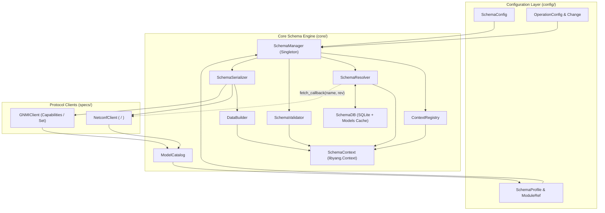
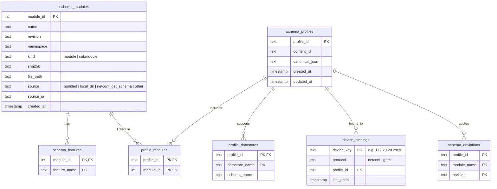

# YANG Schema Management & Validation Engine

## 1. Overview

The [`core`](../core/__init__.py) package implements the protocol-agnostic YANG schema management, compilation, caching, validation, and wire-format serialization engine for `gnmi_client_py`. It bridges immutable configuration models in [`config/schema.py`](../config/schema.py) and [`config/operations.py`](../config/operations.py) with Northbound protocol clients in [`specs/gnmi_client.py`](../specs/gnmi_client.py) and [`specs/netconf_client.py`](../specs/netconf_client.py).

### Module Inventory

| File | Primary Exports | Responsibility |
| :--- | :--- | :--- |
| [`core/__init__.py`](../core/__init__.py) | Package exports | Exposes the public API surface of `./core`. |
| [`core/schema_manager.py`](../core/schema_manager.py) | `SchemaManager` | Thread-safe Singleton facade coordinating all schema subsystems. |
| [`core/schema_context.py`](../core/schema_context.py) | `SchemaContext`, `ContextRegistry` | Wraps and isolates `libyang.Context` instances per `profile_id`. |
| [`core/schema_db.py`](../core/schema_db.py) | `SchemaDB` | SQLite metadata index and atomic SHA-256 verified filesystem cache. |
| [`core/schema_resolver.py`](../core/schema_resolver.py) | `SchemaResolver` | Recursively resolves `import`/`include` graphs and loads modules in topological order. |
| [`core/schema_catalog.py`](../core/schema_catalog.py) | `ModelCatalog`, `ModelCatalogEntry` | Translates protocol capability metadata (e.g., gNMI `ModelData`) into YANG `ModuleRef` tuples. |
| [`core/schema_validator.py`](../core/schema_validator.py) | `SchemaValidator` | Enforces schema node existence, `config false` write protection, and leaf type constraints. |
| [`core/schema_data.py`](../core/schema_data.py) | `DataBuilder` | Constructs `libyang` `DataNode` trees from semantic `Change` objects or RFC 7951 dicts. |
| [`core/schema_serializer.py`](../core/schema_serializer.py) | `SchemaSerializer` | Serializes `DataNode` trees into namespaced NETCONF XML or gNMI RFC 7951 JSON. |
| [`core/schema_errors.py`](../core/schema_errors.py) | `SchemaError` subclasses | Typed exception hierarchy for resolution, caching, validation, and serialization failures. |

---

## 2. Architecture & Data Flow



---


## 3. Component Reference

### 3.1 `SchemaManager` ([`core/schema_manager.py`](../core/schema_manager.py))

Thread-safe Singleton (`threading.RLock`) acting as the single entry point for application code.

| Method | Signature | Description |
| :--- | :--- | :--- |
| `initialize` | `(global_cache_dir: Optional[Union[str, Path]] = None) -> None` | Re-initializes `SchemaDB` and `SchemaResolver` against a custom cache directory. |
| `reset_instance` | `@classmethod () -> None` | Closes the SQLite connection, clears `ContextRegistry`, and resets the Singleton for test isolation. |
| `get_or_create_context` | `(profile: Union[str, SchemaProfile], search_dirs: Sequence[Union[str, Path]] = ()) -> SchemaContext` | Returns an isolated `SchemaContext`. If a `SchemaProfile` is provided, persists it in `SchemaDB` and loads its modules. |
| `load_module_file` | `(file_path: Union[str, Path], profile_id: str, search_dirs: Sequence = ()) -> None` | Indexes a local `.yang` file in `SchemaDB`, resolves transitive dependencies, and compiles it into `profile_id`'s context. |
| `load_module_str` | `(module_content: str, profile_id: str, name: Optional[str] = None, revision: Optional[str] = None, search_dirs: Sequence = ()) -> None` | Stores an in-memory YANG string into `SchemaDB` (when `name` is supplied) and compiles it into the target context. |
| `resolve_and_load` | `(module_name: str, revision: Optional[str], profile_id: str, search_dirs: Sequence = (), fetch_callback: Optional[Callable] = None) -> None` | Resolves a module and its dependency closure across local directories, `SchemaDB`, and `fetch_callback`. |
| `validate_path` | `(path: Union[str, PathSelector], profile_id: str, operation: Optional[OperationConfig] = None) -> Any` | Validates path existence and operation writability (`config false` checks) against `profile_id`. |
| `validate_payload` | `(path: Union[str, PathSelector], value: Any, profile_id: str, operation: Optional[OperationConfig] = None) -> None` | Validates a leaf/container value against the target node's YANG type constraints. |
| `validate_and_serialize_netconf_edit` | `(changes: Sequence[Change], profile_id: str, default_operation: str = "merge") -> str` | Validates all changes and returns a namespaced XML payload for NETCONF `<edit-config>`. |
| `validate_and_serialize_gnmi_change` | `(change: Change, profile_id: str) -> str` | Validates a single `Change` and returns an RFC 7951 JSON string for gNMI `Set`. |

---

### 3.2 `SchemaDB` ([`core/schema_db.py`](../core/schema_db.py))

Manages the SQLite schema metadata catalog (`schema_cache.db`) and atomic model file storage (`models/`).



#### Atomic Caching Pipeline (`store_module_content`)
1. Computes SHA-256 over the UTF-8 YANG source text.
2. Detects submodules via `^\s*submodule\s+` regex; sets `kind="submodule"` and disables standalone `libyang` verification (`verify_with_libyang=False`).
3. Writes content to a temporary file (`tempfile.mkstemp`) inside `models_dir`.
4. If `verify_with_libyang=True`, parses the temporary file in a scratch `libyang.Context` to reject malformed YANG syntax before committing.
5. Atomically renames the temporary file to `<name>@<revision>.yang` (or `<name>.yang`) via `os.replace()`.
6. Upserts metadata into `schema_modules` and `schema_features` within a thread-locked SQLite transaction.

#### Inspection & Query Helpers
- `find_module(name, revision=None, sha256=None) -> Optional[Path]`: Resolves a cached file path and validates its SHA-256 integrity on disk.
- `save_profile(profile: SchemaProfile) -> str`: Persists a profile, its datastores, deviations, and links matching `module_id` rows in `profile_modules`.
- `bind_device(device_key, protocol, profile_id)` / `get_device_profile_id(device_key)`: Associates target endpoints (e.g., `172.20.20.2:830`) with a `profile_id`.
- `get_profile_modules(profile_id)`, `get_module_features(module_name, revision)`, `get_device_binding_info(device_key)`, `get_database_statistics()`, `list_modules()`.

---

### 3.3 `SchemaContext` & `ContextRegistry` ([`core/schema_context.py`](../core/schema_context.py))

- `SchemaContext` wraps a `libyang.Context` instance with an `RLock` and exposes thread-safe operations: `parse_module_file`, `parse_module_str`, `get_module`, `has_module`, `find_path`, `create_data_path`, `parse_data_mem`, and `add_search_dir`.
- `ContextRegistry` initializes `libyang.Context(search_path=..., disable_searchdir_cwd=True)` per `profile_id` so the current working directory never implicitly leaks unrelated `.yang` files into a profile.

---

### 3.4 `SchemaResolver` ([`core/schema_resolver.py`](../core/schema_resolver.py))

`SchemaResolver.ensure_module()` resolves a module and its transitive `import` and `include` graph using a 4-tier lookup hierarchy:

1. **Active `SchemaContext`**: Checks `context.has_module(module_name, revision)` and ensures the module's directory is registered in `context.search_dirs`.
2. **Configured `search_dirs`**: Scans local directories for `<name>@<revision>.yang`, `<name>.yang` (verifying internal `revision` statement when a specific revision is requested), or the newest `<name>@*.yang` when `revision is None`.
3. **Local SQLite Cache (`SchemaDB`)**: Queries `schema_db.find_module(name, revision)`.
4. **Protocol `fetch_callback`**: Invokes `fetch_callback(module_name, revision)` (e.g., NETCONF `<get-schema>`), stores the downloaded content in `SchemaDB` with `verify_with_libyang=False`, and continues resolution.

Before compiling the target module into `libyang`, `ensure_module()` extracts all `import` and `include` blocks via regex (`extract_dependencies()`) and recursively resolves every dependency first.

---

### 3.5 `SchemaValidator` ([`core/schema_validator.py`](../core/schema_validator.py))

- `validate_path(path, schema_context, operation=None)`:
  - Accepts a raw XPath string or `PathSelector`.
  - Strips XPath list key predicates (`re.sub(r'\[[^\]]+\]', '', cleaned_path)`) to query schema node definitions via `schema_context.find_path()`.
  - Raises `InvalidSchemaPathError` if no schema node matches.
  - When `operation` is a `SetOperation` or `EditConfigOperation`, checks `schema_node.config_false()` and raises `SchemaValidationError` if the target node is read-only (`config false`).
- `validate_payload(path, value, schema_context, operation=None)`:
  - Validates the path first, then tests constructing the data node via `schema_context.create_data_path(data_path, value=str(value))` to enforce YANG type, range, pattern, and enum constraints.

---

### 3.6 `DataBuilder` & `SchemaSerializer` ([`core/schema_data.py`](../core/schema_data.py), [`core/schema_serializer.py`](../core/schema_serializer.py))

- `DataBuilder.build_from_changes(schema_context, changes)`: Iterates over `Sequence[Change]`, creating `DataNode` trees via `parse_data_mem(..., fmt="json")` for `dict`/`list` values or `create_data_path()` for scalar values, merging each node into a single root `DataNode`.
- `SchemaSerializer.serialize_netconf_edit_config()`: Serializes the `DataNode` to XML and injects `xmlns:nc="urn:ietf:params:xml:ns:netconf:base:1.0" nc:operation="<op>"` on the root element when the operation differs from `"merge"`.
- `SchemaSerializer.serialize_gnmi_update()`: Serializes a `Change` into RFC 7951 IETF JSON (`<module>:<container>`).

---

### 3.7 Exception Hierarchy ([`core/schema_errors.py`](../core/schema_errors.py))

```text
SchemaError (Exception)
 ├── SchemaNotFoundError          # Missing YANG file in search_dirs, SchemaDB, and protocol callback
 ├── SchemaDependencyError        # Unresolvable import/include or libyang compilation error
 ├── SchemaProfileConflictError   # Incompatible module revisions within a profile
 ├── SchemaValidationError        # Read-only (config false) mutation or leaf value constraint failure
 │    └── InvalidSchemaPathError  # XPath does not resolve to any compiled schema node
 ├── SchemaSerializationError     # DataNode construction or XML/JSON serialization failure
 ├── SchemaCacheError             # SQLite failure, atomic write failure, or verification failure
 └── SchemaDiscoveryError         # Unmapped gNMI ModelData or capability discovery failure
```

---

## 4. Known Gotchas & Operational Nuances

> [!IMPORTANT]
> **1. Submodules Cannot Be Parsed Directly by `libyang`**
> Calling `libyang.Context.parse_module_file()` directly on a YANG `submodule` (e.g., `openconfig-aaa-tacacs`, which is included by `openconfig-aaa`) raises `LibyangError: Input data contains submodule which cannot be parsed directly`.
> - **How `./core` handles this:** Both `SchemaDB.store_module_content()` and `SchemaResolver.ensure_module()` inspect the source text with `re.search(r'^\s*submodule\s+', content, re.MULTILINE)`. Submodules are saved to the search directory and indexed in SQLite with `kind="submodule"`, but skipped from direct `parse_module_file()` calls so `libyang` automatically includes them when parsing the parent module.

> [!WARNING]
> **2. C-Level Search Directory Synchronization (`ly_ctx_set_searchdir`)**
> Appending a `Path` to `SchemaContext.search_dirs` in Python does not automatically inform the underlying `libyang` C context if the `libyang.Context` was already instantiated.
> - **How `./core` handles this:** `SchemaContext.add_search_dir()` invokes `lib.ly_ctx_set_searchdir(self.yang.cdata, str2c(str(d_path)))` via `_libyang` CFFI bindings whenever a new directory is added dynamically.

> [!NOTE]
> **3. SQLite Foreign Key Constraint on `device_bindings`**
> `SchemaDB` enables `PRAGMA foreign_keys = ON;`. The `device_bindings.profile_id` column has a `FOREIGN KEY(profile_id) REFERENCES schema_profiles(profile_id) ON DELETE CASCADE` constraint.
> - **Requirement:** Always persist the `SchemaProfile` via `db.save_profile(profile)` **before** calling `db.bind_device(device_key, protocol, profile_id)`. Calling `bind_device` with an unregistered `profile_id` raises `sqlite3.IntegrityError: FOREIGN KEY constraint failed`.

> [!TIP]
> **4. Feature-Conditional Schema Nodes (`if-feature`)**
> In `libyang`, YANG nodes gated by `if-feature` (such as `/ipi-streaming-telemetry:telemetry-system/vrfs` gated by `if-feature feature-list:HAVE_VRF` in OcNOS) are disabled by default unless the feature is enabled on the module. Path validation (`find_path`) will only resolve unconditional nodes (e.g., `/ipi-streaming-telemetry:telemetry-system/global/config`) unless the corresponding feature is enabled.

---

## 5. Usage Examples

### 5.1 Compiling Vendor YANG Models & Validating XPaths

```python
from pathlib import Path
from core import SchemaManager
from config.operations import SetOperation, Change, ChangeType

mgr = SchemaManager()
srl_dir = Path("tests/yang/srlinux")

# 1. Create an isolated context for Nokia SRLinux and load models + dependencies
sctx = mgr.get_or_create_context(profile="srlinux", search_dirs=[srl_dir])
mgr.resolve_and_load(
    module_name="openconfig-interfaces",
    revision=None,
    profile_id="srlinux",
    search_dirs=[srl_dir],
)

# 2. Validate a writable path and payload
set_op = SetOperation(changes=[
    Change(
        path="/openconfig-interfaces:interfaces/interface[name='ethernet-1/1']/config/description",
        value="Uplink to Core",
        operation=ChangeType.REPLACE,
    )
])
mgr.validate_path(set_op.changes[0].path, profile_id="srlinux", operation=set_op)
mgr.validate_payload(set_op.changes[0].path, set_op.changes[0].value, profile_id="srlinux", operation=set_op)

# 3. Serialize for NETCONF <edit-config> or gNMI Set
netconf_xml = mgr.validate_and_serialize_netconf_edit(set_op.changes, profile_id="srlinux")
gnmi_json = mgr.validate_and_serialize_gnmi_change(set_op.changes[0], profile_id="srlinux")
```

### 5.2 Dynamic Schema Resolution with Protocol Callback

```python
from pathlib import Path
from core import SchemaDB, ContextRegistry, SchemaResolver

db = SchemaDB()
registry = ContextRegistry()
resolver = SchemaResolver(schema_db=db)
sctx = registry.get_or_create_context(profile_id="ocnos_derived")

def fetch_via_netconf(mod_name: str, rev: str | None) -> str | None:
    # Invoked automatically by SchemaResolver when module is missing from local dirs and SchemaDB
    return netconf_client.fetch_schema_text(mod_name, rev)

resolver.ensure_module(
    context=sctx,
    module_name="ipi-interface",
    search_dirs=[Path("tests/yang/ocnos_derived")],
    fetch_callback=fetch_via_netconf,
)
```

