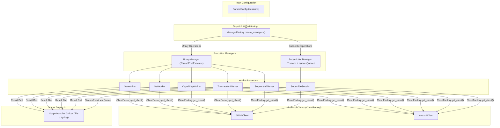

# Orchestration & Concurrency Layer (`managers/`)

## 1. Overview

The [`managers/`](__init__.py) package provides the concurrency, worker lifecycle, and orchestration engine for **`netmgnt-client-py`**. It acts as the bridge between declarative [`SessionConfig`](../config/model.py) instances and protocol-specific clients in [`specs/`](../specs/).

The layer cleanly separates execution into two concurrency models:
1. **Unary Orchestration ([`UnaryManager`](manager.py)):** Runs bounded, one-shot RPCs (`capability`, `get`, `set`, `get-schema`, `transaction`) using a managed `concurrent.futures.ThreadPoolExecutor`.
2. **Streaming Telemetry ([`SubscriptionManager`](manager.py)):** Manages continuous, long-lived subscriptions (`STREAM`, `ONCE`, `POLL`, RFC 5277 notifications) using dedicated worker threads and a centralized thread-safe `queue.Queue`.

---

## 2. Module Inventory

| File | Primary Exports | Responsibility |
| :--- | :--- | :--- |
| [`managers/manager.py`](manager.py) | `ManagerFactory`, `UnaryManager`, `SubscriptionManager`, `BaseRPCManager` | Top-level execution entry point, session partitioning, thread management, and output routing. |
| [`managers/factory.py`](factory.py) | `ClientFactory`, `ValidatorFactory` | Instantiates protocol client drivers (`GNMIClient`, `NetconfClient`) and offline validators. |
| [`managers/unary_worker.py`](unary_worker.py) | `BaseUnaryWorker`, `GetWorker`, `SetWorker`, `CapabilityWorker`, `TransactionWorker`, `SequentialWorker` | Protocol-agnostic worker implementations for single-request RPC execution and multi-step sequential pipelines. |
| [`managers/subscribe_session.py`](subscribe_session.py) | `SubscribeSession` | Encapsulates a streaming telemetry connection, event loop consumption, and queue delivery. |

---

## 3. Architecture & Concurrency Flow



---

## 4. Key Component Reference

### 4.1 `ManagerFactory` ([`managers/manager.py`](manager.py))
Static orchestration coordinator serving as the main execution entry point:
* **`create_managers(cfg: ParsedConfig) -> Tuple[List[BaseRPCManager], List[OutputHandler]]`**:
  Inspects all `sessions` inside `ParsedConfig` and partitions them:
  * Operations inheriting from unary models (`GetOperation`, `SetOperation`, `CapabilitiesOperation`, `TransactionOperation`) are assigned to a `UnaryManager`.
  * Operations of type `SubscribeOperation` are assigned to a `SubscriptionManager`.
  * Instantiates centralized [`OutputHandler`](../modules/output.py) instances shared across all managers.
* **`execute(cfg: ParsedConfig)`**:
  Orchestrates execution across all created managers within a `finally:` block that guarantees output sinks and file descriptors are cleanly closed.

### 4.2 `UnaryManager` ([`managers/manager.py`](manager.py))
Executes non-streaming operations concurrently:
* Uses `concurrent.futures.ThreadPoolExecutor(max_workers=...)` where workers execute independently.
* Automatically resolves the appropriate worker subclass based on operation type:
  * Single `GetOperation` / `GetSchemaOperation` -> [`GetWorker`](unary_worker.py)
  * Single `SetOperation` -> [`SetWorker`](unary_worker.py)
  * Single `CapabilitiesOperation` -> [`CapabilityWorker`](unary_worker.py)
  * Single `TransactionOperation` -> [`TransactionWorker`](unary_worker.py)
  * Multiple operations in a session (`operations > 1`) -> [`SequentialWorker`](unary_worker.py)

### 4.3 `SubscriptionManager` ([`managers/manager.py`](manager.py))
Supervises continuous, real-time telemetry streaming:
* Spins up dedicated background threads (`threading.Thread`) per [`SubscribeSession`](subscribe_session.py).
* Multiplexes incoming [`StreamEvent`](../specs/stream_types.py) data into a shared `queue.Queue`.
* Consumes messages in the main thread and safely dispatches them to [`OutputHandler`](../modules/output.py).
* Automatically launches an interactive CLI controller (`_interactive_poll_controller`) when any session uses `POLL` mode.
* Traps `KeyboardInterrupt` (Ctrl+C) to trigger graceful shutdowns across all gRPC and SSH sessions.

### 4.4 Worker Classes ([`managers/unary_worker.py`](unary_worker.py))
Workers isolate operational execution from transport protocols:
* **`SequentialWorker`**: Executes an ordered pipeline of operations within a single client connection context manager (`with client:`), ensuring transaction continuity (e.g. `lock` -> `edit-config` -> `validate` -> `commit` -> `unlock`).
* **`SetWorker`**: Performs offline syntax path validation against [`GNMIValidator`](../modules/validate.py) before dispatching mutations over the wire.
* **`GetWorker` / `CapabilityWorker` / `TransactionWorker`**: Formats standardized response dictionaries containing `session_id`, `target`, `rpc`, `data`, and `protocol`.

### 4.5 `ClientFactory` ([`managers/factory.py`](factory.py))
Instantiates concrete protocol client implementations:
* `get_client(protocol, target, username, password, security, **kwargs)`: Returns either a [`GNMIClient`](../specs/gnmi_client.py) or [`NetconfClient`](../specs/netconf_client.py) configured with connection parameters and schema configurations.

---

## 5. Usage Examples

### 5.1 Executing Sessions via `ManagerFactory`
```python
from ui.cmd import build_args, config_builder
from managers.manager import ManagerFactory

# Parse CLI arguments into ParsedConfig
args = build_args(["gnmi", "capability", "--target", "172.20.20.2:57401", "-i"])
cfg = config_builder(args)

# Execute via ManagerFactory with automated lifecycle management
ManagerFactory.execute(cfg)
```

### 5.2 Direct Unary Worker Invocation
```python
from config.model import SessionConfig, ConnectionConfig, Protocol
from config.operations import GetOperation
from config.selectors import PathSelector
from managers.unary_worker import GetWorker

# Define session
session = SessionConfig(
    connection=ConnectionConfig(
        target="172.20.20.2:57401",
        username="admin",
        password="NokiaSrl1!",
        insecure=True,
    ),
    protocol=Protocol.GNMI,
    operation=GetOperation(
        selector=PathSelector(paths=("/system/state/hostname",)),
    ),
)

# Run worker directly
worker = GetWorker(config=session)
result = worker.start()
print("Result:", result["data"])
```

