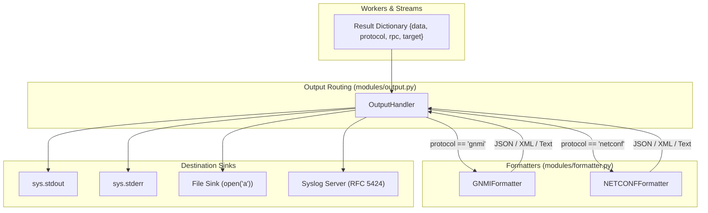

# Cross-Cutting Infrastructure Modules (`modules/`)

## 1. Overview

The [`modules/`](__init__.py) package provides supporting cross-cutting utilities for **`netmgnt-client-py`**. It handles telemetry destination routing, protocol-aware formatters, security credential management (TLS/SSH), centralized RFC 5424 logging, and XPath string parsing.

These components are protocol-agnostic, allowing managers, workers, and clients to route telemetry, format outputs, and enforce security policies consistently.

---

## 2. Module Inventory

| File | Primary Exports | Responsibility |
| :--- | :--- | :--- |
| [`modules/output.py`](output.py) | `OutputHandler` | Centralized telemetry sink router directing structured output to STDOUT, STDERR, local files, or Syslog servers. |
| [`modules/formatter.py`](formatter.py) | `ProtocolFormatter`, `GNMIFormatter`, `NETCONFFormatter` | Transforms raw protocol responses (Protobuf messages, raw XML strings, `lxml` trees) into JSON, XML, or readable text. |
| [`modules/logger.py`](logger.py) | `setup_logger` | Configures application logging levels, file logging, and RFC 5424 UDP/TCP syslog forwarding. |
| [`modules/security.py`](security.py) | `SecurityProfile`, `SecurityModule` | Encapsulates TLS certificate paths and SSH key configurations, generating SSL contexts and SSH kwargs. |
| [`modules/path.py`](path.py) | `parse_path`, `parse_xpath_keys`, `to_path_elem` | Parses XPath string syntax with key-value predicates into Protobuf `gnmi_pb2.Path` structures. |
| [`modules/validate.py`](validate.py) | `GNMIValidator` | Offline validator verifying gNMI path structures against gNMI specifications. |

---

## 3. Architecture & Data Flow



---

## 4. Key Component Reference

### 4.1 `OutputHandler` ([`modules/output.py`](output.py))
Routes structured telemetry messages to destination streams:
* **Instantiation:** Initialized once per output defined in [`ParsedConfig`](../ui/cmd.py).
* **`write(message: dict)`:** Accepts standardized worker dictionaries (`{'target': ..., 'protocol': ..., 'rpc': ..., 'data': ...}`). Automatically invokes the matching protocol formatter and writes to the configured stream.
* **`close()`:** Safely flushes and closes active file handles on shutdown.

### 4.2 Formatters ([`modules/formatter.py`](formatter.py))
Converts heterogeneous wire responses into normalized formats:
* **`GNMIFormatter`**:
  * Unpacks Protobuf `Notification`, `Update`, `TypedValue`, and JSON-IETF byte payloads.
  * Injects telemetry metadata (`source`, `subscription_name`, `timestamp`).
* **`NETCONFFormatter`**:
  * Uses `xmltodict` to convert XML responses into structured Python dictionaries.
  * Formats and highlights `<rpc-error>` payloads into clean diagnostic reports.
  * Strips XML namespaces where appropriate for readable JSON representations.

### 4.3 `SecurityModule` & `SecurityProfile` ([`modules/security.py`](security.py))
Manages authentication credentials and encryption keys:
* **TLS Parameters:** CA certificate (`tls_ca`), client certificate (`tls_cert`), private key (`tls_key`), server name verification (`tls_server_name`), and TLS version negotiation (`tls_version`).
* **SSH Parameters:** Private SSH key path (`ssh_key`), passphrase, and known hosts handling.
* **`get_grpc_credentials()`**: Assembles `grpc.ssl_channel_credentials` for secure gNMI channels.
* **`get_ssh_kwargs()`**: Assembles `ncclient` authentication arguments.

### 4.4 `parse_path` ([`modules/path.py`](path.py))
Robust XPath string parser for gNMI paths:
* Converts `/interfaces/interface[name=mgmt0]/state/counters` into Protobuf `Path` and `PathElem` messages.
* Parses multi-key predicates (`[key1=val1][key2=val2]`).
* Preserves path origins (`openconfig:/interfaces`).
* Raises typed exceptions (`MalformedXPathError`, `MalformedXPathKeyError`) on invalid syntax.

---

## 5. Usage Examples

### 5.1 Parsing an XPath into a gNMI Protobuf Path
```python
from modules.path import parse_path

path_str = "openconfig:/interfaces/interface[name=eth0]/state/oper-status"
gnmi_path = parse_path(path_str)

print("Origin:", gnmi_path.origin)  # openconfig
for elem in gnmi_path.elem:
    print(f"Element: {elem.name}, Keys: {dict(elem.key)}")
```

### 5.2 Configuring Output Handling
```python
from config.model import OutputConfig, OutputType, OutputFormat
from modules.output import OutputHandler

# Configure file output in JSON format
cfg = OutputConfig(
    output_type=OutputType.FILE,
    format=OutputFormat.JSON,
    path="/tmp/network_telemetry.json",
)

handler = OutputHandler(cfg)
handler.write({
    "target": "172.20.20.2:57401",
    "protocol": "gnmi",
    "rpc": "get",
    "data": {"hostname": "router1.iad01"},
})
handler.close()
```

