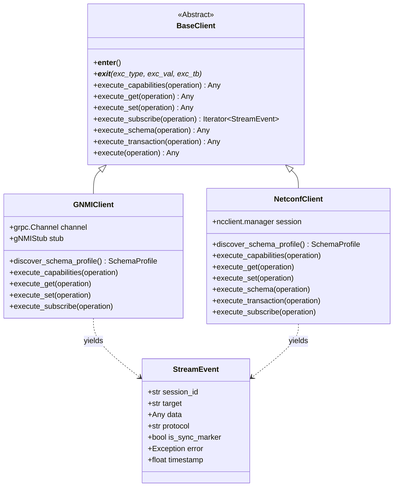

# Protocol Implementation & Client Drivers (`specs/`)

## 1. Overview

The [`specs/`](__init__.py) package implements the concrete Northbound protocol client drivers and offline validators for **`netmgnt-client-py`**. It translates protocol-neutral semantic intents from [`config/operations.py`](../config/operations.py) into wire-level frames over gRPC (HTTP/2) and NETCONF (SSH/TLS).

The package is anchored around the [`BaseClient`](base_client.py) abstract base class, which establishes an extensible, unified contract across all network management protocols.

---

## 2. Module Inventory

| File | Primary Exports | Responsibility |
| :--- | :--- | :--- |
| [`specs/base_client.py`](base_client.py) | `BaseClient`, `UnsupportedOperationError` | Abstract Base Class defining semantic execution contracts and context manager lifecycles. |
| [`specs/gnmi_client.py`](gnmi_client.py) | `GNMIClient` | High-performance gNMI client implementation using `grpcio` and Protobuf stubs. |
| [`specs/netconf_client.py`](netconf_client.py) | `NetconfClient` | Full-featured NETCONF client built on `ncclient` supporting candidate transactions, locking, and RFC 5277. |
| [`specs/stream_types.py`](stream_types.py) | `StreamContext`, `StreamEvent`, `StreamCommand`, `StreamCommandType` | Normalized telemetry streaming data structures and flow control queues. |
| [`specs/base_validator.py`](base_validator.py) | `BaseValidator` | Base validator contract for offline path and syntax validation. |
| [`specs/gnmi_validator.py`](gnmi_validator.py) | `GNMIValidator` | Validates gNMI path formatting according to gNMI specifications. |
| [`specs/netconf_validator.py`](netconf_validator.py) | `NetconfValidator` | Validates NETCONF XPath expressions and Subtree XML filter syntax. |
| [`specs/gnmi/`](gnmi/) | `gnmi_pb2.py`, `gnmi_pb2_grpc.py`, `gnmi_ext_pb2.py` | Precompiled Protocol Buffer stubs for gNMI. |

---

## 3. Architecture & Class Hierarchy



---

## 4. Key Component Reference

### 4.1 `BaseClient` ([`specs/base_client.py`](base_client.py))
The standard abstract base class implemented by all protocol drivers:
* **Context Manager (`with client:`):** Handles initialization, connection establishment, and clean socket/channel teardown.
* **Semantic Dispatch (`execute(operation)`):** Introspects the given [`OperationConfig`](../config/operations.py) instance and routes it to the matching concrete handler (`execute_get`, `execute_set`, `execute_subscribe`, etc.).

### 4.2 `GNMIClient` ([`specs/gnmi_client.py`](gnmi_client.py))
Implements gNMI over HTTP/2 using `grpcio`:
* **Capabilities Discovery (`execute_capabilities`):** Queries server version, supported encodings, and `ModelData` descriptors.
* **Get Operations (`execute_get`):** Supports single or multiple target paths, common prefixes, and configurable encodings (`JSON_IETF`, `JSON`, `BYTES`, `PROTO`, `ASCII`).
* **Set Operations (`execute_set`):** Supports `update`, `replace`, and `delete` mutations. Automatically invokes [`SchemaManager`](../core/schema_manager.py) when schema validation is enabled to encode mutations into RFC 7951 JSON trees.
* **Streaming Telemetry (`execute_subscribe`):**
  * Maps [`DeliveryMode`](../config/delivery.py) into wire `SubscriptionList` modes (`STREAM`, `ONCE`, `POLL`) and `SubscriptionMode` (`SAMPLE`, `ON_CHANGE`, `TARGET_DEFINED`).
  * Yields normalized [`StreamEvent`](stream_types.py) objects. Supports interactive manual poll triggering via a dedicated command queue.

### 4.3 `NetconfClient` ([`specs/netconf_client.py`](netconf_client.py))
Implements NETCONF (RFC 6241) over SSH/TLS using `ncclient`:
* **Capabilities (`execute_capabilities`):** Extracts capabilities exchanged during the `<hello>` sequence.
* **Datastore Retrieval (`execute_get`):** Handles `<get>` (operational state + running) and `<get-config>` across `running`, `candidate`, or `startup` datastores using XPath or Subtree XML filters.
* **Dynamic Schema Discovery (`execute_schema`):** Retrieves YANG model source code directly from the router via RFC 6022 `<get-schema>`.
* **Safe Configuration Mutations (`execute_set`):**
  * Assembles `<edit-config>` XML subtrees with operation attributes (`operation="merge|replace|delete|remove"`).
  * Automatically coordinates datastore locking (`--lock`) and candidate verification (`--validate`).
  * Enforces atomic transaction safety: automatically catches `RPCError` and invokes `<discard-changes>` before releasing locks.
  * Supports confirmed commits (`--confirmed`, `--confirm-timeout`, `--persist`).
* **Event Notifications (`execute_subscribe`):** Implements RFC 5277 streaming telemetry over NETCONF, parsing incoming `<notification>` XML envelopes into normalized [`StreamEvent`](stream_types.py) structures.

### 4.4 Normalized Streaming (`StreamEvent` & `StreamContext`) ([`specs/stream_types.py`](stream_types.py))
Decouples streaming telemetry representations from protocol wire encodings:
* **`StreamEvent`**: Encapsulates payload data, timestamp, source target, protocol, sync markers (`sync_response`), and exceptions.
* **`StreamContext`**: Controls streaming lifecycle state (`is_running`, `command_queue`).

---

## 5. Usage Examples

### 5.1 Programmatic `GNMIClient` Usage
```python
from specs.gnmi_client import GNMIClient
from config.operations import GetOperation
from config.selectors import PathSelector

# Establish gNMI session
with GNMIClient(target="172.20.20.2:57401", username="admin", password="password123", insecure=True) as client:
    # Query capabilities
    caps = client.capability()
    print("gNMI Version:", caps.get("gnmi_version"))

    # Execute Get
    result = client.execute_get(
        GetOperation(selector=PathSelector(paths=("/interfaces/interface[name=mgmt0]/state",)))
    )
    print("State:", result)
```

### 5.2 Programmatic `NetconfClient` Candidate Edit with Lock
```python
from specs.netconf_client import NetconfClient
from config.operations import SetOperation, Change, ChangeType
from config.protocol_options import NetconfOptions

with NetconfClient(target="172.20.20.2:830", username="admin", password="password123") as client:
    # Edit candidate datastore with lock and commit
    op = SetOperation(
        changes=(
            Change(
                path="/interfaces/interface[name=mgmt0]/config/description",
                operation=ChangeType.MERGE,
                value="Configured via NetconfClient",
            ),
        ),
        protocol_options=NetconfOptions(
            target_datastore="candidate",
            lock_target=True,
            commit=True,
        ),
    )
    reply = client.execute_set(op)
    print("Edit Reply:", reply)
```

